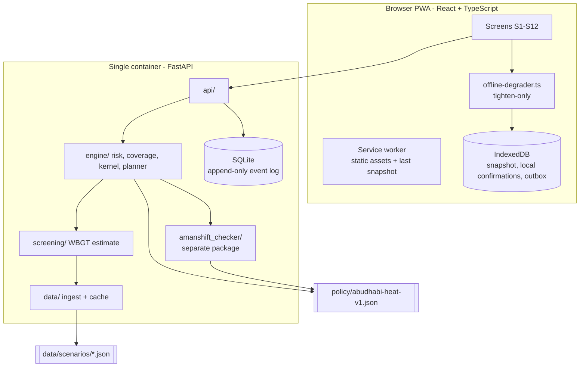
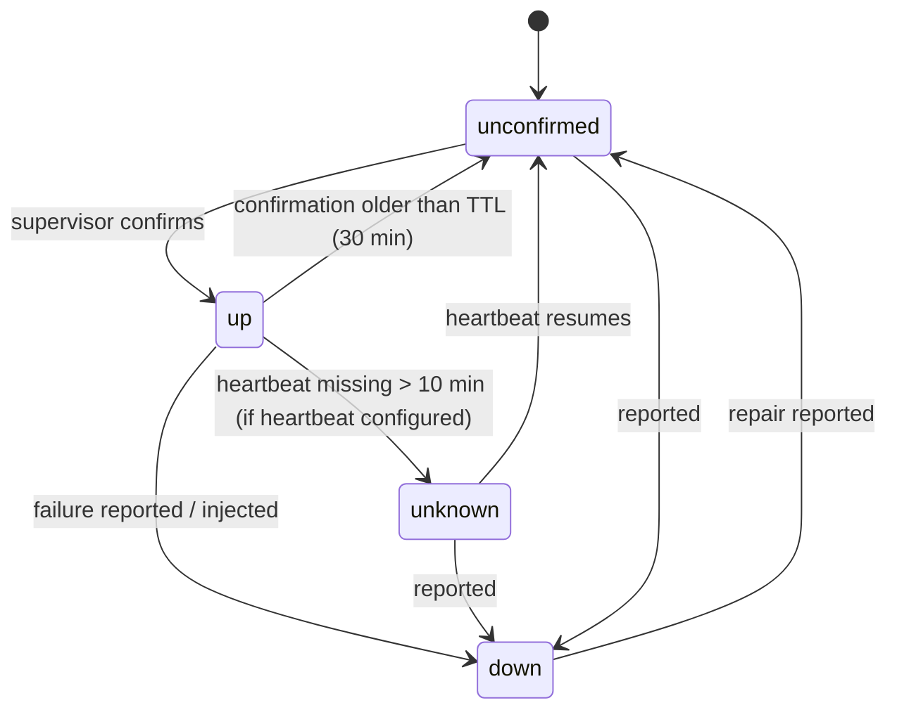

# 03 — System Architecture

Status: FROZEN for implementation (v1.0, 2026-11-19). Design target: one developer, ~20 engineering hours, deadline 20 Nov 2026.

> Implementation note (2026-11-19, STATUS SC2): `day_evidence` is merged into `env`; `env` carries the whole local day of forecast evidence plus meter readings.

## 1. Architectural stance

- **Python is the source of truth** for screening, risk, coverage, kernel, planner and checker.
- **The browser holds no decision logic except one function:** the offline degrader, which can only tighten cached levels. Offline devices never re-plan.
- **Planner and checker are separate packages** with no shared code. Both read the same versioned policy file.
- **No worker identities, biometrics or worker locations** exist anywhere in the system.

## 2. System context

```mermaid
flowchart LR
  OM[Open-Meteo<br/>Previous Runs + Forecast API] -->|hourly forecast| AS
  IEM[Iowa Environmental Mesonet<br/>OMAA METAR archive] -->|observations, eval only| EV[Evaluation harness]
  SUP[Site supervisor<br/>tablet / laptop] <-->|HTTPS + offline cache| AS[AmanShift]
  WRK[Workers<br/>shared crew screen / printed card] <-- crew cards --- AS
  MED[Site medic / HSE manager] <-- escalations, site view --- AS
  MTR[Onsite WBGT/TWL meter<br/>manual entry] --> SUP
```

## 3. Containers



## 4. Repository and module responsibilities

| Path | Responsibility | May import |
|---|---|---|
| `backend/amanshift/data/` | Fetch, cache (file cache keyed by URL hash), provenance stamps | stdlib, httpx, pandas |
| `backend/amanshift/screening/` | Estimated WBGT (sun and shade) via `thermofeel.calculate_wbgt_liljegren`; solar geometry via `pvlib` | data |
| `backend/amanshift/policy/` | Load and validate the policy JSON (pydantic) | — |
| `backend/amanshift/engine/risk.py` | Crew Risk Engine: effective WBGT, limits, level, max work fraction | screening, policy |
| `backend/amanshift/engine/coverage.py` | Protection Coverage Graph | policy |
| `backend/amanshift/engine/kernel.py` | Fail-Safe Decision Kernel: trust, uncertainty sets, permitted actions, recovery | risk, coverage |
| `backend/amanshift/engine/planner.py` | Intervention planner (assignment + action selection) | kernel, scipy |
| `backend/amanshift_checker/` | Independent rule checker | policy JSON file only, stdlib, pydantic |
| `backend/amanshift/api/` | FastAPI routes, scenario replay, failure injection | all of the above |
| `backend/amanshift/store/` | SQLite event log | stdlib sqlite3 |
| `backend/eval/` | Evaluation scripts writing `eval/out/*` | everything |
| `web/src/` | UI, i18n, offline degrader | — |

`amanshift_checker` must not import `amanshift`. A test parses every checker module's AST and fails on any such import (T-IND-01).

## 5. Domain entities (pydantic)

```python
class Provenance(BaseModel):
    source: Literal["open-meteo-forecast","open-meteo-previous-runs","iem-metar","onsite-meter","climatology","manual"]
    kind: Literal["measured","forecast","derived","fallback"]
    issued_at: datetime | None      # model run / measurement time
    valid_at: datetime
    retrieved_at: datetime
    url_hash: str | None

class EnvEvidence(BaseModel):
    zone_id: str                    # site-wide forecast evidence is replicated per zone
    meter_location: Literal['sun','shade'] | None = None   # meters only
    wbgt_sun_c: float | None
    wbgt_shade_c: float | None
    twl_wm2: float | None           # only from onsite meter, never computed
    provenance: Provenance

class Crew(BaseModel):
    crew_id: str                    # "C1".."C12"; no person identities
    size: int                       # 1..30
    workload: Literal["light","moderate","heavy","very_heavy"]
    ppe: Literal["work_clothes","cloth_coveralls","double_layer_cloth","sms_coveralls","polyolefin_coveralls","limited_use_vapor_barrier"]  # NIOSH Table 3-2
    acclimatization: Literal["acclimatized","unacclimatized","mixed"]
    exposure: Literal["direct_sun","shaded_outdoor","indoor_unconditioned"]
    zone_id: str
    escalation_active: bool = False

class Resource(BaseModel):
    resource_id: str
    type: Literal["shade","cooled_rest","water"]
    zone_id: str
    capacity: int                   # persons; water: persons served
    state: Literal["up","unconfirmed","unknown","down"]
    last_confirmed_at: datetime | None
    last_heartbeat_at: datetime | None

class SiteGraph(BaseModel):
    zones: list[str]
    walk_min: dict[tuple[str,str], float]  # symmetric, minutes

class Snapshot(BaseModel):          # the fixed evaluation context
    snapshot_id: str                # sha256 of canonical JSON
    site_id: str
    eval_time: datetime
    policy_version: str
    env: list[EnvEvidence]
    crews: list[Crew]
    resources: list[Resource]
    graph: SiteGraph
    connectivity: Literal["online","degraded","offline"]
    prev_eval: dict[str, PrevEval]  # per crew: raw_level, f_max, all_fresh, at (previous 15-min tick)
    day_evidence: list[EnvEvidence] # remaining hours of the local day (for defer and checker)
```
Evaluation runs on fixed 15-minute ticks. Ageing for demos/tests is done by back-dating `retrieved_at`/`last_confirmed_at`, never by moving `eval_time`.

## 6. Database schema (SQLite)

```sql
CREATE TABLE payloads (            -- purgeable; the chain stores only the digest
  event_id TEXT PRIMARY KEY REFERENCES events(event_id),
  payload_json TEXT NOT NULL
);
CREATE TABLE events (
  event_id     TEXT PRIMARY KEY,             -- uuid4
  site_id      TEXT NOT NULL,
  occurred_at  TEXT NOT NULL,                -- ISO 8601 UTC
  recorded_at  TEXT NOT NULL,
  kind         TEXT NOT NULL CHECK (kind IN (
    'snapshot','plan_proposed','checker_verdict','plan_approved','override',
    'resource_state','failure_injected','symptom_escalation','alert_issued',
    'alert_acknowledged','offline_sync')),
  crew_id      TEXT,                          -- never a person
  payload_sha256 TEXT NOT NULL,
  prev_hash    TEXT NOT NULL,                 -- hash chain for tamper evidence
  hash         TEXT NOT NULL
);
CREATE INDEX idx_events_site_time ON events(site_id, occurred_at);
```

Events are append-only and hash-chained over `payload_sha256`; payload rows for `symptom_escalation` are deleted after 30 days without breaking the chain.

## 7. API contracts

Envelope: `{ "data": ..., "error": null | {"code","message","details"}, "meta": {"request_id","policy_version","snapshot_id"} }`.

| Method | Path | Purpose |
|---|---|---|
| GET | `/api/v1/health` | liveness |
| GET | `/api/v1/scenarios` | list replay scenarios |
| POST | `/api/v1/scenarios/{id}/load` | reset demo site to scenario at t0 |
| GET | `/api/v1/sites/{site}/state?at=ISO` | snapshot + crew levels + coverage + permitted actions |
| POST | `/api/v1/sites/{site}/failures` | inject failure `{type: resource_down|forecast_stale|network_offline|meter_reading, target, value}` |
| POST | `/api/v1/sites/{site}/resources/{rid}/confirm` | supervisor physical confirmation |
| POST | `/api/v1/sites/{site}/plans` | run planner → plan + checker verdict |
| POST | `/api/v1/sites/{site}/plans/check` | check an arbitrary submitted plan (used for the unsafe-plan demo) |
| POST | `/api/v1/sites/{site}/escalations` | crew-level symptom escalation |
| GET | `/api/v1/sites/{site}/offline-pack` | snapshot + 12 h hourly levels + cards + expiry, for the PWA |
| GET | `/api/v1/evaluation` | evaluation artifacts from `eval/out/` |

Representative `/plans` response:

```json
{"data":{
  "plan_id":"p-7f3a","snapshot_id":"sha256:91c…","status":"feasible",
  "objective":{"unprotected_weighted_persons":0,"walk_person_minutes":42,"changes":1},
  "actions":[
    {"crew_id":"C2","action":"work","work_fraction":0.25,"rest_resource":"R3","water_resource":"W1","clinical_escalation":false,
     "reason_codes":["LEVEL_3","R2_DOWN","REASSIGNED"]},
    {"crew_id":"C4","action":"stop","rest_resource":null,"clinical_escalation":false,"reason_codes":["LEVEL_4","NO_COVERAGE"]}],
  "checker":{"verdict":"approved","checker_version":"chk-1.0","violations":[],"rules_evaluated":10}},
 "error":null,"meta":{"request_id":"…","policy_version":"abudhabi-heat-v1","snapshot_id":"sha256:91c…"}}
```

Rejected plan: `"checker":{"verdict":"rejected","violations":[{"rule":"C4","crew_id":"C2","message":"Rest resource R2-cooled is DOWN","citation":"doc05 §8 C4"}]}`.

## 8. Protection Coverage Graph

Bipartite graph G = (Crews ∪ Resources, E). Edge (c, r) exists iff `walk_min(zone(c), zone(r)) ≤ policy.max_walk_min[r.type]` **and** `trusted_up(r, t)`. A crew is **covered** iff the plan assigns it a rest resource (shade or cooled_rest) and a water resource via existing edges, with capacities respected. Details and pseudocode: doc 05 §4.

## 9. Planner formulation

Normative definition: doc 05 §6. P0 = deterministic greedy planner + checker; P1 = 4-stage lexicographic MILP (`scipy.optimize.milp`) replacing greedy when it passes the same tests. Only options in A_c exist; capacity is shared across crews of different sizes.

## 10. Checker architecture and independence

| Property | How it is enforced |
|---|---|
| No shared code | Separate package; AST import test T-IND-01 |
| Different formulation | Planner optimizes; checker evaluates 11 declarative predicates (doc 05 §8) and recomputes limits with its own table lookups |
| Same policy, separate parsing | Checker parses the JSON with its own schema; policy file has golden tests against cited source values (T-POL-*) |
| Fixed context | Plan carries `snapshot_id`; checker refuses a plan whose snapshot hash differs (rule C8) |
| Known residual risk | Same developer and same policy file ⇒ common-mode errors remain possible. Stated in docs 02, 07, 11 |

Plans are applied only if `verdict == approved`. Rejections are logged and shown with rule citations.

## 11. Event processing and state transitions

Every input change (time tick of 15 min, failure injection, confirmation, meter entry, escalation, connectivity change) creates a new Snapshot → kernel → planner → checker → events. Resource state machine:



Only `up` creates edges. Recovery always passes through `unconfirmed` and requires a fresh physical confirmation.

## 12. Offline architecture

- `/offline-pack` returns: snapshot, crew levels for the next 12 h in 15-min steps (computed online with forecast evidence), instruction cards, `pack_issued_at`, `stale_after` (60 min), `expires_at` (3 h).
- Service worker caches the app shell and the latest pack (stale-while-revalidate). IndexedDB stores local confirmations and an outbox.
- The pack holds, per crew and 15-min step, `planned_level` and server-computed `worst_case_level` (stale forecast tier + all resources unconfirmed). `offline-degrader.ts` (≤ 60 lines) displays `max(planned, worst_case if elapsed ≥ stale_after or confirmations expired)` and 4 after `expires_at` (STOP-HOLD: stop, shade, water, contact supervisor). It only takes maxima of server-computed values, so it never shows a level below the cached plan.
- Local supervisor confirmations offline may *restore* a resource to `up` for the coverage display only if the pack marked the resource `up` at issue; they never lower the cached level. Outbox syncs on reconnect and the server recomputes.

## 13. Failure propagation

| Failure | Detection | Effect |
|---|---|---|
| Cooling unit down | Injected / reported; heartbeat timeout if configured | Edges removed → crews uncovered → planner re-plans; ORANGE crews without coverage → RED |
| Forecast stale | `retrieved_at` age > 3 h or `issued_at` age > 30 h | Uncertainty set widens: add margin, floor at climatology p99 (doc 02 §7) |
| Forecast missing | Fetch error | Climatological p99 bound for month×hour |
| Network offline (client) | `navigator.onLine` + failed sync | Offline degrader (server-precomputed worst case) |
| Meter reading higher than estimate | Manual entry | Use the max (meters can only tighten in MVP) |
| Checker crash | Exception | Plan not applied; previous approved plan kept; levels still shown; alert "checker unavailable" |
| Planner infeasible | Crews on BIG | Those crews `stop_work`; site banner "insufficient protection capacity" |

## 14. Data provenance

Every displayed number carries a provenance chip (source, measured/forecast/derived/fallback, issued, age). Evaluation outputs record dataset URLs, retrieval time, row counts and file SHA-256 in `eval/out/manifest.json`.

## 15. Deployment

- One Docker image: FastAPI serves `/api` and the built PWA as static files. SQLite on a volume.
- Public: Render or Fly.io free tier (choose whichever deploys first; doc 09). Demo state is kept **per browser session** (cookie-keyed in-memory store, max 200 sessions, LRU) with a Reset button, so concurrent judges do not interfere. Demo data is synthetic site + cached real weather; no secrets needed (Open-Meteo and IEM need no key).
- Local fallback: `make demo` → `docker compose up` → `http://localhost:8080`. Offline demo works from the cached scenario without internet.

## 16. Architecture decision records

| ADR | Decision | Reason | Rejected |
|---|---|---|---|
| ADR-01 | Python backend, logic server-side | thermofeel/pvlib/scipy are Python; one source of truth | All-TypeScript engine (would duplicate screening) |
| ADR-02 | Offline = tighten-only degrader, no offline re-planning | Device cannot know resource states; simplest provable behaviour | Offline planner in WASM |
| ADR-03 | Greedy (P0) then lexicographic `scipy.optimize.milp` (P1) | Greedy is fast to ship and checkable; MILP handles shared capacity exactly; both already in scipy | `linear_sum_assignment` (cannot express shared capacity with mixed crew sizes), CP-SAT |
| ADR-04 | Separate checker package, declarative predicates | Logical independence judges can inspect | Assertions inside planner |
| ADR-05 | SQLite append-only hash-chained log | Zero ops, auditable | Postgres |
| ADR-06 | thermofeel Liljegren for estimated WBGT | Apache-2.0, peer-reviewed method, ECMWF-maintained | Custom formulas, `calculate_wbgt_simple` (no radiation term) |
| ADR-07 | No TWL computation; TWL accepted only from meters | No validated open implementation found | Hand-written TWL |
| ADR-08 | React + Vite + vite-plugin-pwa | Fast to build, service-worker tooling | Server-rendered HTML (weaker offline story) |
| ADR-09 | Synthetic site, real weather | No real worksite data available or needed; labelled everywhere | Fake "real" site |
